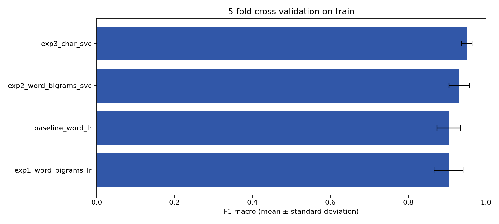
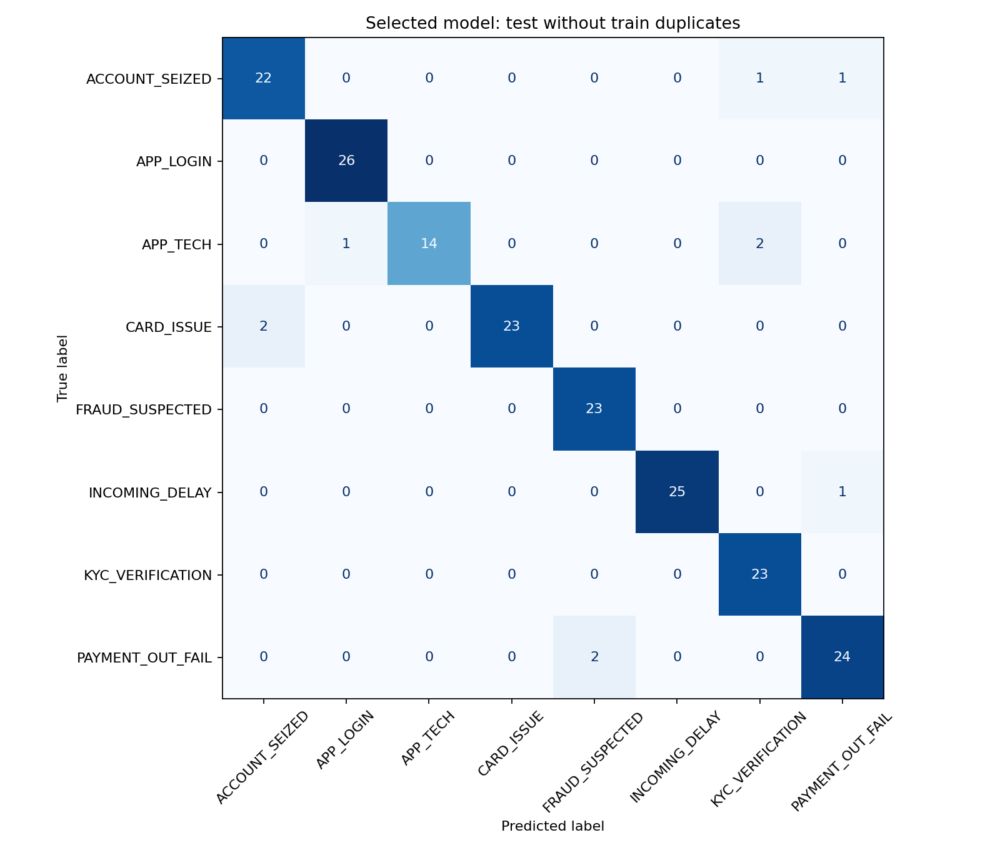
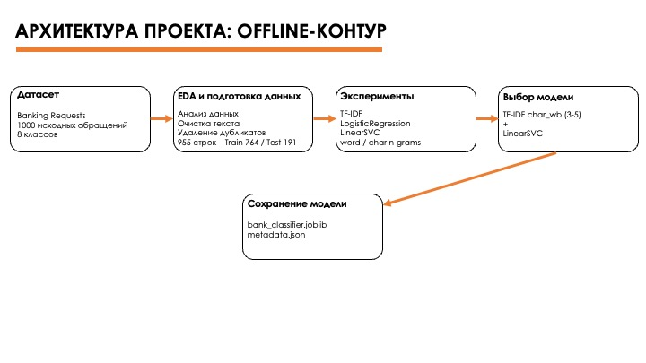
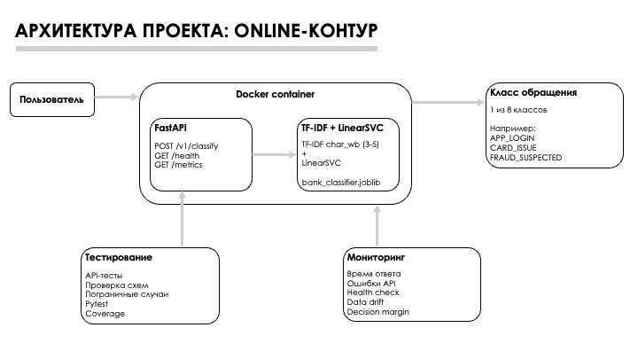

# Отчёт по проекту «Сервис автоматической классификации обращений клиентов банка в техподдержку»

**Курс:** «Интеграция искусственного интеллекта в разработку»  
**Команда:** Команда 2  
**Репозиторий:** https://github.com/yasinnsbts/integ_ai_in_dev_nlp  
**Формат проекта:** учебный end-to-end ML/NLP-сервис

---

## 1. Постановка задачи

Служба поддержки банка ежедневно получает обращения в свободной текстовой форме: клиент может сообщить, что не может войти в приложение, не видит поступивший перевод, столкнулся с блокировкой карты или подозревает мошенническую операцию. До того как обращение попадёт к нужному специалисту, его необходимо определить в тематическую категорию. При ручной маршрутизации сотрудник должен прочитать сообщение, понять его тему и выбрать очередь обработки. На большом потоке это увеличивает время первичной обработки и создаёт риск ошибочной маршрутизации.

В рамках проекта команда разработала прототип сервиса, который автоматически классифицирует короткое русскоязычное банковское обращение и возвращает одну из восьми категорий:

| Класс | Содержание обращения |
|---|---|
| `PAYMENT_OUT_FAIL` | проблема с исходящим платежом |
| `INCOMING_DELAY` | задержка входящего перевода или начисления |
| `APP_LOGIN` | проблема со входом в приложение |
| `APP_TECH` | техническая проблема приложения |
| `FRAUD_SUSPECTED` | подозрение на мошенничество |
| `CARD_ISSUE` | проблема с банковской картой |
| `ACCOUNT_SEIZED` | ограничение или блокировка счёта |
| `KYC_VERIFICATION` | проблема с идентификацией и проверкой документов |

Практический сценарий: внешняя система передаёт текст обращения в API, сервис определяет категорию, после чего этот результат может использоваться для предварительной маршрутизации обращения в соответствующую очередь поддержки.

Целью работы было решить сквозной инженерный кейс, в котором нужно связать постановку бизнес-задачи, работу с данными, сравнение моделей, тестирование, API, контейнеризацию и мониторинг. Поэтому важным результатом проекта является не только качество классификации, но и воспроизводимость экспериментов, проверка рисков и понятные границы применимости решения.

---

## 2. Данные и контроль их качества

Для обучения использован учебный датасет `Banking Requests`, содержащий 1000 коротких русскоязычных обращений восьми классов. Для моделирования используются текст обращения `text` и целевая метка `label`.

Подготовка данных: команда удаляла лишние пробелы и дубликаты, но не применяла лемматизацию, стемминг и удаление стоп-слов. Для коротких пользовательских сообщений формы слов, части слов, цифры, сокращения и опечатки могут содержать полезный сигнал, поэтому агрессивная нормализация могла бы удалить часть информации. После очистки осталось 955 обращений, которые были стратифицированно разделены на 764 обучающих и 191 тестовое наблюдение.

На этом этапе была обнаружена проблема, которая повлияла на дальнейший экспериментальный протокол. При дополнительном аудите текстов после приведения к нижнему регистру и нормализации пробелов выяснилось, что внутри train есть повторяющиеся формулировки, а одна строка test совпадает с текстом из train. Если оставить такое пересечение без контроля, итоговая метрика может быть немного завышена: модель фактически проверяется на формулировке, которую уже видела.

Поэтому в проект были внесены две меры защиты от утечки данных. Во-первых, при кросс-валидации применяется `StratifiedGroupKFold`: одинаковые нормализованные тексты объединяются в одну группу и не могут одновременно оказаться в обучающей и валидационной частях одного фолда. Во-вторых, основная итоговая оценка считается на 190 тестовых обращениях = строка, совпадающая с train, исключается именно из основной метрики. Результат на полном test из 191 строки сохраняется только для сопоставимости.

Этот эпизод стал важной частью проекта: проверка качества данных показала реальный риск, который не был заметен по одним только пропускам, типам и распределению классов. Таким образом, валидация данных использовалась не формально, а повлияла на способ оценки модели.

---

## 3. Эксперименты и выбор модели

Первой моделью был baseline на основе TF-IDF по словам и `LogisticRegression`. Затем команда провела три эксперимента, последовательно меняя признаки и классификатор. Все варианты сравнивались на одинаковой 5-fold кросс-валидации только внутри обучающей выборки. Тестовые данные в выборе модели и параметров не участвовали.

Основной метрикой выбран `Macro F1`. Такой вариант подходит для многоклассовой задачи, поскольку каждый из восьми классов получает одинаковый вес независимо от числа примеров в нём. Это особенно важно для менее представленных категорий.

| Вариант | Признаки | Классификатор | CV Macro F1 |
|---|---|---|---:|
| Baseline | TF-IDF по словам | LogisticRegression | 0.9043 |
| Эксперимент 1 | TF-IDF word n-grams | LogisticRegression | 0.9042 |
| Эксперимент 2 | TF-IDF word n-grams | LinearSVC | 0.9311 |
| Эксперимент 3 | TF-IDF `char_wb`, n-grams 3–5 | LinearSVC | **0.9505** |

Первый эксперимент показал, что само добавление словесных биграмм почти не меняет результат Logistic Regression. Более заметный прирост появился после перехода к `LinearSVC`. Лучший результат был получен при сочетании `LinearSVC` и символьных n-грамм `char_wb` длиной от 3 до 5 символов.

Такой результат объясняется тем, что символьные признаки способны учитывать части слов и близкие написания, поэтому для коротких пользовательских сообщений они потенциально устойчивее к словоформам и некоторым опечаткам. При этом в проекте это рассматривается именно как обоснованная гипотеза о признаках: отдельного эксперимента на специально внесённых опечатках команда не проводила.

Финальная конфигурация улучшила средний `Macro F1` относительно пересчитанного baseline на 4,62 процентного пункта. Дополнительно выросло качество менее стабильного класса `APP_TECH`: на out-of-fold прогнозах его F1 увеличился примерно с 0,838 до 0,879, а recall = с 0,770 до 0,838.

Результаты экспериментов сохранены в репозитории и используются как воспроизводимый артефакт сравнения моделей:



После выбора лучшая конфигурация была обучена на всём train и один раз оценена на отложенной тестовой выборке без пересечения с train:

| Метрика | Значение |
|---|---:|
| Accuracy | 0.9474 |
| Macro Precision | 0.9509 |
| Macro Recall | 0.9431 |
| Macro F1 | **0.9450** |

Правильно классифицированы 180 из 190 обращений. Ошибки по классам дополнительно анализируются через сохранённую confusion matrix:



Результат подтверждает работоспособность выбранного подхода в рамках текущего датасета, но сам по себе не доказывает такое же качество на реальном банковском трафике: выборка небольшая и учебная.

---

## 4. Архитектура и технологический стек

После экспериментальной части модель была оформлена не как отдельный ноутбук, а как сервис с разделёнными контурами обучения и применения.

**Offline-контур** отвечает за подготовку данных, эксперименты, кросс-валидацию, выбор модели и создание модельного артефакта:

`данные → проверка → эксперименты → выбор модели → обучение на train → сохранение`

**Online-контур** использует уже готовую модель:

`текст обращения → FastAPI → валидация → ML-pipeline → класс + decision_margin → ответ`

Архитектура обоих контуров вынесена в отдельные схемы репозитория:





Финальная модель сохраняется в `models/bank_classifier.joblib` как единый `Pipeline`, включающий TF-IDF-векторизатор и `LinearSVC`. Это снижает риск рассинхронизации предобработки и классификатора. Дополнительно сохраняются отдельные `vectorizer.joblib` и `classifier.joblib`, а в `metadata.json` фиксируются версия окружения, параметры, seed, хэши данных и артефактов, итоговые метрики и результаты проверки сохранения.

После сериализации выполняется обратная загрузка артефактов. Прогнозы восстановленного pipeline и отдельно загруженной пары `vectorizer + classifier` программно сравниваются с исходными прогнозами на всех 191 тестовых строках. Если они различаются, обучение завершается ошибкой. Эта проверка позволяет убедиться, что сохранённая модель действительно воспроизводит рассчитанный результат.

Для проекта выбран классический стек Python: `pandas` и `NumPy` для данных, `scikit-learn` для TF-IDF, моделей и метрик, `joblib` для сериализации, `FastAPI` и Pydantic для HTTP-интерфейса, `pytest` для тестирования, Docker для воспроизводимого запуска и `prometheus-client` для технических метрик.

Выбор классического ML вместо тяжёлой нейросетевой модели соответствует масштабу задачи. При менее чем тысяче коротких текстов TF-IDF + LinearSVC оказался простым, быстрым, интерпретируемым с инженерной точки зрения и дал высокий результат без дорогостоящего обучения и отдельной GPU-инфраструктуры.

---

## 5. API, тестирование и воспроизводимость

Для использования модели реализован FastAPI-сервис. Основной метод `POST /v1/classify` принимает одно обращение и возвращает его категорию. Дополнительно сервис предоставляет `GET /health` для проверки загрузки модели и `GET /metrics` для технических метрик. Swagger/OpenAPI позволяет вручную проверить контракт через браузер.

Пример запроса:

```json
{
  "text": "Не могу войти в мобильное приложение"
}
```

Пример ответа:

```json
{
  "label": "APP_LOGIN",
  "decision_margin": 1.0889875640647964
}
```

Помимо класса API возвращает `decision_margin` = разницу между двумя наибольшими значениями `decision_function` модели. Этот показатель помогает видеть, насколько сильно лучший класс отделяется от ближайшего конкурента. Важно, что `decision_margin` **не является вероятностью** и не должен интерпретироваться как процент уверенности модели.

Автоматические тесты проверяют здоровье сервиса, классификацию примеров всех восьми классов, валидацию пустого и слишком длинного текста, отсутствие обязательного поля, доступность метрик, структуру train-датасета и допустимость меток. Отдельный тест сверяет значение `decision_margin`, рассчитанное API, непосредственно с двумя максимальными score модели.

Зафиксированный результат проекта = **17 из 17 тестов успешно пройдены**, покрытие кода API составляет **79%**.

Воспроизводимость экспериментов поддерживается и на уровне обучения. В `train_model.py` зафиксирован seed `42`, число фолдов, набор кандидатов и правило выбора победителя. В `reports/experiments/` сохраняются результаты по моделям и фолдам, out-of-fold прогнозы, итоговые тестовые метрики, classification report, confusion matrix и ошибочные тестовые примеры. Благодаря этому выбор финальной модели можно проследить от исходных данных до сохранённого артефакта, а не только увидеть финальное число в презентации.

Полноценная система experiment tracking, например MLflow, не использовалась. Для масштаба учебного проекта версии кода хранятся в Git, а результаты экспериментов = в автоматически формируемых CSV, JSON, Markdown и графических артефактах репозитория.

---

## 6. Контейнеризация и маршрут запуска

API упакован в Docker-образ на базе `python:3.13-slim`. При сборке устанавливаются зависимости, копируются FastAPI-приложение и сохранённый `bank_classifier.joblib`, после чего сервис запускается через Uvicorn на порту 8000.

Практически были проверены сборка образа, загрузка модели внутри контейнера, работа `/health`, `/v1/classify` и `/metrics`, а также повторный запуск контейнера. Таким образом, проект имеет воспроизводимый учебный маршрут запуска и не зависит от ноутбука, в котором проводились эксперименты.

При этом Docker в данном проекте не следует путать с полноценным production deployment. Не развёрнуты оркестратор, балансировка, registry-пайплайн, CI/CD-доставка, TLS и отдельная инфраструктура секретов. Эти элементы находятся за границами учебной задачи и рассматриваются как возможное дальнейшее развитие.

---

## 7. Мониторинг и реакция на отклонения

Мониторинг был спроектирован в трёх направлениях: техническое состояние сервиса, изменение входных данных и поведение модели.

На уровне API уже экспортируются Prometheus-метрики: количество запросов, latency классификации, счётчик внутренних ошибок и индикатор загрузки модели. Дополнительно доступен `/health`. Для эксплуатационного сценария определены базовые условия реакции: например, рост ошибок, увеличение времени ответа или незагруженная модель должны приводить к проверке сервиса.

Для данных рассматриваются средняя и распределение длины сообщений, доля необычно коротких или длинных текстов и изменение характеристик относительно reference-выборки. В отдельном ноутбуке команда смоделировала явный data drift: средняя длина искусственно изменённых сообщений выросла примерно на 202%, а доля текстов необычной длины достигла 100%. Оба индикатора превысили заданные учебные пороги и получили статус `ALERT`.

Для поведения модели используется `decision_margin`, поскольку `LinearSVC` не предоставляет `predict_proba`. На тестовой выборке средний margin составил 1,163, медианный = 1,238, а доля прогнозов с `decision_margin < 0.35` = 8,90%. В качестве начального порога предложено отслеживать ситуацию, когда доля таких неоднозначных прогнозов превышает 20%, а также изменение доли отдельного класса более чем на 10 процентных пунктов относительно reference.

Важно разделять то, что реализовано, и то, что спроектировано. Эндпоинт `/metrics` уже работает, однако внешний Prometheus, Grafana и автоматическая система уведомлений не развёрнуты. Проверка drift также выполняется offline в ноутбуке, а не непрерывно на потоке запросов.

Сам факт drift не должен автоматически запускать переобучение. Правильная реакция = собрать новые обращения, проверить их разметку, повторно измерить F1/Precision/Recall и только после подтверждённого ухудшения принимать решение о новой версии модели.

---

## 8. Ограничения и риски решения

Главное ограничение проекта связано с данными. Датасет небольшой и учебный, поэтому высокая тестовая метрика характеризует текущее распределение примеров, но не гарантирует аналогичное качество на реальных обращениях банка. В production могут появиться длинные сообщения, жаргон, новые продукты, нестандартные формулировки и изменение языка клиентов со временем.

Второе ограничение = закрытый набор из восьми классов. У модели нет категории `OTHER/UNKNOWN`: любое входное сообщение будет принудительно отнесено к одному из известных классов. Для реального сервиса потребуется механизм отказа от автоматической маршрутизации, отдельный неизвестный класс или передача неоднозначных случаев оператору.

Третье ограничение связано с самой постановкой задачи: текущая модель является single-label классификатором. Обращение, в котором одновременно описаны две разные проблемы, всё равно получит только одну категорию.

Отдельного внимания требуют критичные классы, например подозрение на мошенничество или блокировка счёта. Ошибочная маршрутизация такого обращения может задержать реакцию поддержки. Поэтому текущую модель корректно использовать только как инструмент предварительной сортировки, а не как систему, принимающую финансовые или юридически значимые решения.

При переходе к реальным банковским данным также потребуется отдельно решить вопросы персональных данных: обезличивание обращений, состав логов, сроки хранения и доступ к информации. Использование синтетического учебного датасета позволяет не решать эти вопросы в прототипе, но не отменяет их для реального внедрения.

---

## 9. Использование ИИ-ассистентов

В ходе работы над проектом команда использовала ИИ-ассистентов как вспомогательный инструмент на разных этапах разработки. Они применялись при обсуждении вариантов экспериментов, подготовке тестовых сценариев, проработке структуры API и мониторинга, а также при написании и редактировании документации, README, отчёта и материалов для презентации.

ИИ-ассистенты помогали быстрее находить возможные решения, формулировать альтернативы и проводить дополнительное ревью уже выполненной работы. При этом окончательные решения принимались командой на основе результатов экспериментов, кода и фактического поведения сервиса.

Отдельное внимание уделялось проверке технических формулировок. Например, значение decision_margin, возвращаемое моделью, в документации обозначено именно как оценка уверенности классификатора, а не как вероятность. При проверке данных было выявлено совпадение одного обращения из тестовой выборки с обучающей, поэтому эта запись была исключена из основной итоговой оценки модели. Аналогично при описании мониторинга было разграничено то, что уже реализовано в проекте (/metrics и проверка data drift), и полноценная production-инфраструктура мониторинга, которая в рамках учебного проекта не разворачивалась.

Таким образом, ИИ-ассистенты использовались прежде всего для ускорения анализа, разработки и подготовки материалов, тогда как проверка результатов, выбор окончательных решений и оценка их корректности выполнялись командой.

---

## 10. Распределение ролей в команде

Работа над проектом была разделена по этапам, при этом часть материалов проходила совместную проверку перед объединением в итоговую версию.

| Участник | Вклад в проект |
|---|---|
| **Синельников Ярослав** | лидирование команды; EDA; подготовка данных; baseline; участие в FastAPI и тестировании; Docker; интеграция частей проекта; основная работа по архитектуре и мониторингу; подготовка отчётных материалов |
| **Берсенев Андрей** | проведение и анализ экспериментов; сравнение конфигураций; выбор финальной модели; сохранение и проверка модельных артефактов; **участие в написании README и проверке итоговых материалов** |
| **Казаринова Ольга** | проведение и анализ экспериментов; сравнение моделей; выбор финальной конфигурации; сохранение модели; участие в написании README |
| **Соловьева Снежана** | разработка и проверка FastAPI-сервиса; тестирование API, входных данных и пограничных случаев |
| **Александрова Лада** | участие в проработке архитектуры решения и плана мониторинга; подготовка и проверка материалов по архитектуре, метрикам и условиям алертов |

---

## 11. Итоги

В результате команда собрала сквозной NLP-проект, в котором экспериментальная модель доведена до работающего сервисного прототипа. Проект включает подготовку и аудит данных, baseline и три эксперимента, выбор модели по кросс-валидации, независимую оценку на test, сохранение и проверку ML-артефактов, FastAPI, автоматические тесты, Docker и сценарий мониторинга.

Лучшей стала конфигурация `TF-IDF char_wb (3–5) + LinearSVC`: она получила `Macro F1 = 0.9505` на 5-fold кросс-валидации обучающей выборки и `Macro F1 = 0.9450` на основной тестовой выборке из 190 обращений. Зафиксированы 17 успешно пройденных автоматических тестов и 79% покрытия кода API.

При этом наиболее важным результатом проекта являются не только высокие метрики. В процессе работы команда обнаружила и учла пересечение train/test, исключила одинаковые тексты из разных частей cross-validation, зафиксировала воспроизводимый протокол выбора модели, проверила корректность сохранения артефактов и разделила фактически реализованный мониторинг от запланированной production-инфраструктуры.

Проект показывает, как сравнительно простая NLP-модель может быть встроена в полный инженерный контур. Следующий шаг развития = проверка подхода на более крупном и реалистичном наборе обращений, добавление `OTHER/UNKNOWN` и ручной эскалации, нагрузочное тестирование, подключение внешнего мониторинга и регулярная оценка качества на свежей размеченной выборке. Только после этого можно будет делать выводы о пригодности решения для реального банковского потока.